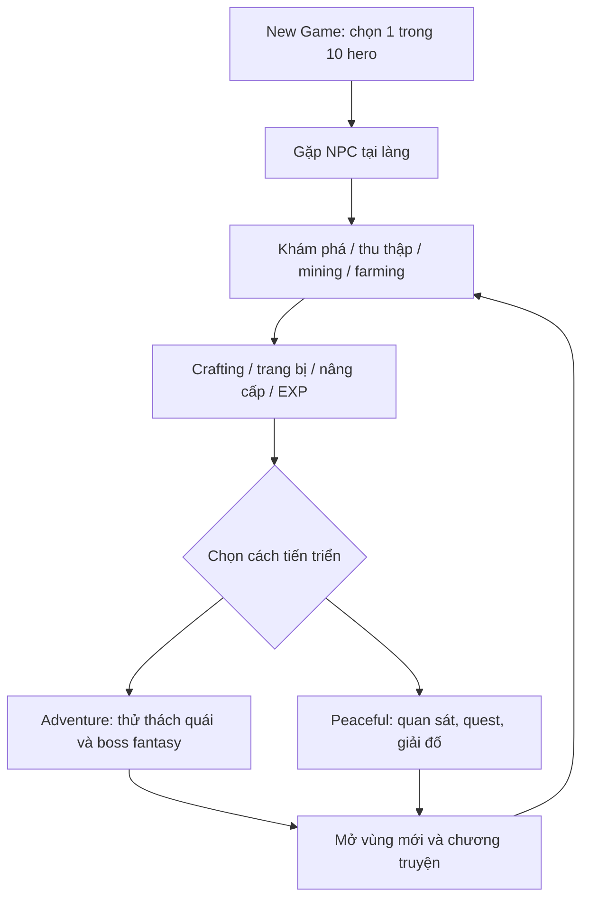
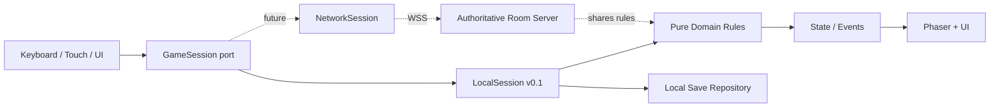

# CELESTIAL HAVEN — Master Game Design & Development Plan v2.0
 
> Your world. Your pace. Your adventure.
>
> Fantasy Adventure ARPG • Character Progression • Gathering & Crafting • NPC & Life Sim • Creature Companions • Optional Co-op
 
- Ngày cập nhật: 25/11/2026. Thay thế v1.0 về phạm vi gameplay; lưu v1 riêng làm lịch sử.
- Chủ dự án: acubibeovip; solo, web-first. Mọi checkbox là công việc chưa xác nhận hoàn thành.
- MVP v0.1: single-player HTML5 trên itch.io, chọn 1/10 hero, thu thập, khai thác, chế tạo, nâng cấp, NPC và một boss fantasy có thể bỏ qua qua tuyến Peaceful.
- Mục tiêu tiếp theo: co-op PvE 2–4 người trong phòng riêng, hỗ trợ nhau và đánh boss; không đợi đến một MMO hoàn chỉnh.
- [Q] dữ liệu quan sát; [G] giả thuyết; [D] quyết định thiết kế; [T] mục tiêu nội bộ. Không coi phạm vi/giá/thời gian là số liệu thị trường.
- Chưa audit asset gốc, chưa tạo repo, chưa chạy game, chưa deploy server. Các danh mục và thông số dựa trên mô tả người dùng.
## 0. Cách dùng
 
Đọc mục 1–7, triển khai từng task tại mục 11. Chỉ tick khi acceptance criteria đạt và lưu bằng chứng. Không tự đổi scope; cập nhật ADR khi có quyết định. Mục 12 có roadmap; mục 15 có prompt coding agent. Mục 18 là bản thiết kế online/co-op độc lập, không phải dependency của MVP.
 
## 1. Nghiên cứu thị trường
 
### 1.1 Executive summary
 
1. **[Q]** Farming kết hợp fantasy, đời sống và phiêu lưu đã có nhiều sản phẩm công khai: Rune Factory, Stardew Valley, Fields of Mistria và Sun Haven [S1–S4]. Đây là tín hiệu thể loại có khách hàng, không phải bằng chứng game mới sẽ thành công.
2. **[Q]** Vua Pháp Thuật (VTC, 2009) từng cung cấp web RPG đánh theo lượt, hệ pet, nghề nghiệp và phát triển trang bị [S5–S7]. Nên học vòng lặp nuôi bạn đồng hành, cảm giác tiến bộ dài hạn và khả năng truy cập bằng trình duyệt; không tái tạo IP.
3. **[G]** Một game có thể hoàn thành cốt truyện không cần chiến đấu, vẫn giữ sinh vật và boss hiện diện trong thế giới, có thể tạo khác biệt cho người chơi cozy. Chưa có khảo sát riêng chứng minh nhu cầu đối với tổ hợp cơ chế này.
4. **[D]** Chọn MVP top-down 2D, làng, nông trại, rừng và mỏ/phế tích; MVP single-player, mở rộng co-op sau. Game có một mục tiêu khôi phục vùng đất với hai phương án hoàn thành.
5. **[D]** Tận dụng catalog hiện có nhưng chỉ dùng subset đã kiểm tra. Giá trị kinh doanh ban đầu là game showcase và phản hồi, không phải tối đa hóa doanh thu hoặc nhồi đủ asset.
### 1.2 Benchmark sản phẩm
 
| Tham khảo | Dữ liệu / cơ chế công khai [Q] | Học hỏi | Không đưa vào MVP |
|---|---|---|---|
| Rune Factory: Guardians of Azuma [S1] | Action RPG + life sim, khôi phục làng, farming, nhân vật và quan hệ | Cốt truyện gắn với sự hồi sinh vùng đất; đời sống và phiêu lưu hỗ trợ nhau | Thế giới 3D, số lượng nội dung và diễn xuất quy mô lớn |
| Stardew Valley [S2] | Country-life RPG mở, chăm sóc nông trại | Một ngày có mục tiêu ngắn, phát triển bằng sinh hoạt | Lịch 4 mùa đầy đủ, nhiều sự kiện và quan hệ ở MVP |
| Fields of Mistria [S3] | Pixel art farming RPG kết hợp phép thuật, romance và phiêu lưu; snapshot Steam hiển thị 97% tích cực trong 25.732 review tiếng Anh (bản lập chỉ mục, không phải thống kê doanh số) | Làng có bản sắc; phục hồi cộng đồng; NPC đáng nhớ | Đồ họa, nhân vật và diễn biến truyện sao chép |
| Sun Haven [S4] | Fantasy farming, nhiều tùy chỉnh; co-op tùy chọn | Farming phép thuật, người chơi được chọn nhịp độ | Online co-op, nhiều khu vực và chủng tộc ở MVP |
| Vua Pháp Thuật [S5–S7] | Web MMO nhập vai, pet, turn-based, nghề, nhiệm vụ | Bạn đồng hành có tiến triển; cấu trúc quest, kỹ năng và nghề | PvP, server, giao dịch, kinh tế online và hệ thống cường hóa ngẫu nhiên |
| Minecraft [S8] | Peaceful giảm/bỏ phần lớn quái thù địch; một số tài nguyên có thể không lấy được qua con đường thông thường | Cho phép điều chỉnh mức thử thách | Không sao chép nhược điểm khóa progression khi bật peaceful |
| itch.io Pixel Art Top Sellers [S9] | Có gói top-down như Cute Fantasy RPG | Demo đồng bộ nhân vật, môi trường, UI có thể hỗ trợ cửa hàng | Suy ra lượng bán từ thứ hạng hoặc rating |
 
**Lưu ý về dữ liệu:** khảo sát nhanh nguồn công khai tại ngày 25/11/2026, không phải census thị trường 2025–2026. Không có dữ liệu doanh thu, conversion hay retention của nhóm khách hàng mục tiêu; không đưa ra dự báo doanh thu. Con số Fields of Mistria là snapshot review tiếng Anh, không phải tất cả người chơi và có thể thay đổi.
 
### 1.3 Nghiên cứu creator theo góp ý
 
| Creator | Bằng chứng đã tìm thấy | Bài học cần thử nghiệm |
|---|---|---|
| Pie_Mastah / PieMastah | Tìm được hồ sơ itch.io cùng tên [S10]; chưa xác minh chắc đúng người hay video thiết kế quái được nhắc | Làm bảng silhouette, hành vi, môi trường sống; tìm đúng video trước khi học kỹ thuật cụ thể |
| JohnBrx | Devlog I Turned My Indie Game Into a Living Ecosystem [S11] | Map có sinh vật và nhịp sống; dùng landmark, đường vòng và các điểm nghỉ; không chỉ xếp tile |
| Challacade | Hồ sơ devlog Moonshire có nội dung thời tiết, trang trí và bản đồ [S12] | Thời tiết có chuyển cảnh, chuyển động và âm thanh; moveset dễ đọc; chưa xác minh chi tiết moveset cụ thể từ video |
 
- [ ] RES-01: Xác nhận đúng kênh/video ba creator, ghi URL, timestamp đoạn cần học, nguyên lý rút ra và thử nghiệm nhỏ của riêng mình.
- [ ] RES-02: Chơi hoặc xem gameplay hợp pháp của 3–5 game benchmark; ghi lại 15 phút đầu, daily loop, UX túi đồ và tiến trình không chiến đấu.
- [ ] RES-03: Tìm 15–20 phản hồi công khai về cozy game, optional combat, mobile HTML5; phân loại vấn đề, không coi mẫu nhỏ là đại diện thị trường.
- [ ] RES-04: Kiểm tra trang Steam/itch.io của các đối thủ ngay trước khi định giá; ghi ngày truy cập và rating, không suy doanh số.
### 1.4 Khách hàng và khác biệt
 
| Nhóm | Nhu cầu | MVP đáp ứng bằng |
|---|---|---|
| Cozy / scenic | Không áp lực, cảnh đẹp, tự do dạo chơi | Peaceful, mưa/nắng, sinh vật, trang trí nhẹ, chế độ ngắm cảnh |
| Fantasy RPG | Tiến triển, khám phá, kỹ năng | Quest, trang bị, level, kỹ năng và ARPG fantasy tùy chọn |
| Pet collector | Gắn bó, khám phá sinh vật | Ba lựa chọn sinh vật đồng hành, nhật ký sinh vật |
| Indie developer | Tìm asset game-ready | Credit/gallery dẫn về asset pack; ví dụ tích hợp thật |
| Người từng chơi Vua Pháp Thuật | Cảm giác pet, nghề, nhiệm vụ, browser RPG | Hướng mở rộng sau MVP, không hứa tái tạo MMO |
 
**[G] Định vị:** một fantasy adventure RPG có hệ thống life sim cho phép người chơi hồi sinh làng bằng sinh hoạt, khám phá hoặc phiêu lưu theo nhịp riêng. Cần kiểm chứng bằng playtest, không tự nhận đây là thị trường ngách chưa có đối thủ.
 
---
 
## 2. Tầm nhìn và định vị
 
[D] Một fantasy adventure RPG nơi người chơi chọn một Celestial Guardian, trở về vùng Starbrook, thu thập tài nguyên, phát triển nghề và trang bị, kết bạn với NPC và sinh vật, khám phá di tích và phục hồi thế giới. Người thích ARPG có thể tham gia thử thách với quái và boss; người thích ngắm cảnh có thể hoàn thành cùng câu chuyện bằng nghiên cứu, chế tạo và giải đố. Về sau bạn bè có thể cùng khám phá và hỗ trợ nhau trong boss encounter.
 
Trụ cột: progression rõ ràng; thế giới sống; tự do lựa chọn; dữ liệu đồng bộ; mobile/browser-first; co-op tự nguyện, không bắt buộc kết nối để chơi cốt truyện.
 
Không sao chép IP, lore, asset, UI của Vua Pháp Thuật hoặc Rune Factory. Không MMO, PvP, giao dịch tự do, chat mở hoặc pay-to-win trong các phiên bản đầu. Không dùng monetization ngẫu nhiên. Quan hệ NPC ưu tiên tình bạn; nếu thêm romance thì là tuyến truyện hư cấu phù hợp lứa tuổi, không cần thiết để tiến triển.
 
## 3. Game design
 
### 3.1 Core loop và first session
 

 
0–5 phút: chọn hero + mode, học di chuyển và tương tác, nhận nhiệm vụ. 5–15 phút: thu thập gỗ, đá, quặng; craft vật phẩm đầu tiên; mở vùng mỏ. 15–40 phút: trang bị, bạn đồng hành, thử thách hoặc giải đố ở đền; hồi sinh làng. [T] Thời lượng cần kiểm chứng. Không phạt offline, đồng hồ single-player dừng ở menu và tab ẩn. Online dùng thời gian phòng do server quản lý.
 
### 3.2 Chọn nhân vật
 
| Hero | Archetype (đề xuất) | Affinity dự kiến | Template v0.1 |
|---|---|---|---|
| Storm Monk | Monk | Thunder | Close |
| Aurora Priestess | Healer | Light | Support |
| Frostfox Sorceress | Mage | Ice | Ranged |
| Earthshaker Sentinel | Guardian | Earth | Close |
| Galeblade Wanderer | Wanderer | Wind | Close |
| Eclipse Reaper | Reaper | Dark | Close |
| Tidebound Dragon General | Lancer | Water | Close |
| Phoenix Blade Dancer | Dancer | Fire | Close |
| Starfall Archer | Archer | Astral | Ranged |
| Spirit Beast Warden | Summoner | Nature | Support |
 
Tên nguyên tố chỉ là nhãn đề xuất, phải map với 13 ID thực tế trong catalog. Tất cả hero chọn được từ New Game; v0.1 dùng 3 template gameplay, khác ngoại hình, portrait, chỉ số khởi đầu có giới hạn; không hứa 10 moveset hoàn chỉnh. MVP chỉ dùng 3 affinity trong encounter (chọn sau audit); các affinity khác không bị phạt, dùng neutral modifier. Sau MVP mở đủ 13 nguyên tố và kỹ năng đặc trưng. Tất cả hero làm được nghề và cả hai route; không khóa cốt truyện theo class. Save giữ heroId, không lưu bản sao toàn bộ definition.
 
### 3.3 Character progression và trang bị
 
- Level 1–10 [T]; EXP từ quest, khám phá, sinh hoạt và encounter. Không bắt buộc combat để lên cấp.
- Inventory 24 ô, stack 99, hotbar 4; equipment slot mainHand, body, accessory. Starter item miễn phí theo template.
- 20 item trang bị (bao gồm bản nâng cấp), 20 nguyên liệu, 15 recipe [T]. Chế tạo ở trạm nghề NPC hoặc UI tương tác. Nâng cấp cấp +0 đến +3, chi phí cố định, không có xác suất mất vật phẩm.
- Item stats là dữ liệu fantasy trừu tượng; bonus cộng dồn có giới hạn, không mô phỏng thao tác chế tạo hoặc sử dụng vũ khí ngoài đời. UI preview kết quả trước xác nhận.
- Mọi thay đổi inventory, craft, upgrade và quest reward là transaction: kiểm tra nguyên liệu, capacity, quyền sở hữu và điều kiện trước commit. Không tiêu hao nếu lỗi, không thưởng hai lần.
- Không cho bán hoặc hủy vật phẩm cốt truyện nếu gây softlock. Có đường lấy lại nguyên liệu thiết yếu.
### 3.4 Bản đồ và nghề
 
| Map | Size tile mục tiêu | Thành phần | Mở khóa |
|---|---|---|---|
| Starbrook Village | 40×32 | NPC, shop, bảng quest, forge, điểm tập trung | Start |
| Farm | 32×24 | Nhà, 12 plot, rương, giếng | Start |
| Whisperwood | 40×32 | Cây, thảo dược, hồ, sinh vật | Tutorial |
| Crystal Hollow | 40×32 | Quặng, hang, cửa đền, boss room nội bộ | Quest |
 
Tile 32×32, top-down 3/4; fixed maps, landmark, path, collision, exit markers. Dungeon boss có thể là scene nhỏ trong Crystal Hollow, không tính thêm khu vực lớn. Resources có ID instance, respawn theo ngày game, tương tác bằng nút, không mini-game phức tạp. Farming 6 loại cây, 12 plot, tưới/thu hoạch; mưa tưới tự động. Mining/gathering cung cấp tài nguyên cho recipe, không yêu cầu farming để chơi ARPG, và ngược lại.
 
### 3.5 NPC, quest và đời sống
 
| NPC | Vai trò | Quest/chức năng |
|---|---|---|
| Mira | Trưởng làng | Tutorial, chapter, phục hồi làng |
| Rowan | Nông dân | Hạt giống, farming, recipe |
| Orin | Thợ rèn fantasy | Crafting, nâng cấp trang bị |
| Luma | Nhà nghiên cứu | Pet, bestiary, dấu ấn đền |
| Neris | Thương nhân / hướng dẫn | Shop, tài nguyên, bản đồ |
 
Mỗi NPC có dialogue ID, 2 lịch sinh hoạt, portrait, trạng thái quest, shop hoặc chức năng. 3–5 đoạn hội thoại/người tối thiểu; tình bạn 0–3 mức. Không dùng AI runtime cho hội thoại. Shop giá cố định, tiền trong game. NPC có thể bán nguyên liệu thiết yếu để chống softlock. Quest track cá nhân; online NPC là entity chung nhưng dialogue/quest reward theo từng người, không khóa NPC khi người khác nói chuyện.
 
### 3.6 Sinh vật, pet, thời tiết và encounter fantasy
 
8 loài quái gốc, tối đa 16 biến thể; 3 lựa chọn pet, một pet active. Dùng state idle/wander/rest/follow; Adventure có encounter tự nguyện với chỉ số và hiệu ứng fantasy, feedback rõ ràng, không đồ họa máu me. Peaceful luôn giữ sinh vật và boss trong map dưới trạng thái trung lập, không bị tấn công hoặc gây hại; pet từ nhiệm vụ/chăm sóc. Pet có bond 0–3, follow và bonus nhẹ; tiến hóa, kỹ năng riêng và breeding để sau. Weather clear/rain/mist; day/night; RNG có seed; không khóa quest vào weather hiếm. Đêm có ambient tùy chọn.
 
### 3.7 Một chương, hai con đường
 
| ID | Quest | Điều kiện |
|---|---|---|
| q_arrive | Gặp Mira | Chọn hero, tutorial, starter kit một lần |
| q_gather | Làm quen rừng | Thu thập 3 gỗ/2 thảo dược fantasy |
| q_mine | Khám phá mỏ | Thu thập quặng |
| q_craft | Gặp Orin | Chế tạo vật phẩm fantasy đầu tiên |
| q_upgrade | Cải thiện trang bị | Hoàn thành nâng cấp hoặc công cụ sinh hoạt tương đương |
| q_pet | Gặp Luma | Kết bạn một sinh vật |
| q_farm | Hỗ trợ Rowan | Thu hoạch (side quest) |
| q_shrine | Đền sao | Peaceful hoặc Adventure |
| q_restore | Trả ánh sáng | Flag shrine_restored, reward một lần |
| q_epilogue | Làng hồi sinh | Cutscene/credits, tiếp tục tự do |
 
Void Devourer là boss showcase; bản top-down phải được chuẩn bị riêng. Adventure: tham gia encounter fantasy tùy chọn, dùng ba template năng lực, hiệu ứng có tín hiệu rõ; có retry và rời encounter không mất quest item. Peaceful: quan sát boss đang ngủ hoặc di chuyển, tìm ba dấu ấn, tạo đèn sao và giải đố. Hai route gọi chung `completeShrine()` và cùng mở map/cốt truyện, reward progression tương đương. Không khóa nguyên liệu thiết yếu sau encounter. Đổi mode ngoài encounter. Chỉ mở co-op adventure nếu mọi người chọn tham gia; không kéo người Peaceful vào encounter. Có thể gặp bạn bè ở làng bình yên trong online phase sau.
 
### 3.8 UX
 
Title: New Game, Continue, Import Save, Settings, Credits; Online/Co-op chỉ xuất hiện sau khi feature đạt gate. Character Select: 10 cards, portrait, preview, template, affinity, chọn mode. HUD: HP/mana fantasy nếu Adventure, level/EXP, hotbar, quest, đồng hồ, nút tương tác. Menu: inventory/equipment, crafting, upgrade, skills, journal, bestiary, pet, map, settings. Desktop WASD/arrows + E + hotkeys; mobile joystick và nút tương tác, skill buttons, tap UI; target 44 CSS px, không hover-only, hỗ trợ reduced motion. Tiếng Anh mặc định, string key để thêm Việt. Landscape ưu tiên, không chặn portrait; pause chỉ local. Online không pause cả phòng.
 
## 4. Phạm vi MVP và acceptance
 
| Hệ | v0.1 Must [T] | Sau MVP |
|---|---|---|
| Hero | 10 chọn được, 3 template | 10 moveset riêng |
| Level/gear | L1–10, 20 gear, +0..+3 | Build sâu hơn |
| Resources | 20 material, 15 recipe | Nghề, kinh tế phong phú |
| Maps | 4, một đền boss | Nhiều biome |
| NPC | 5, 10 quest gồm side quest | Lịch, relationship, lễ hội |
| Creatures | 8 loài, tối đa 16 biến thể, 3 pet | 64 loài, 832 biến thể |
| Elements | 3 active, còn lại neutral | 13 active |
| Boss | 1, hai con đường | Nhiều boss, co-op |
| Life sim | 6 cây, 12 plot, 3 weather | Mùa, câu cá, nấu ăn, trang trí |
| Platform | HTML5 desktop/mobile, local save | Online riêng, PC/mobile wrapper |
 
Scope cut theo thứ tự nếu trễ: giảm biến thể, giảm recipe không thiết yếu, giảm side quests và animation trang trí; giữ 10 hero chọn được nếu asset đủ, 2 route, gathering/mining/upgrade, 1 boss, NPC chức năng và save. Nếu hero chưa đủ asset top-down, báo blocker và dùng preview trong dev build, không quảng cáo đủ 10 trước khi QA.
 
Done: new game từ mọi hero; hoàn thành chương bằng Peaceful không combat và Adventure; gear upgrade không dup/trừ sai; save/load/export/import; NPC/quest không softlock; build ZIP itch chạy từ subpath và iframe; desktop + mobile thật; tối thiểu 5 tester tự nguyện. [T] ZIP ≤25 MB, initial payload ≤10 MB, 30 FPS ổn định trên máy chuẩn đã chọn; đo thực tế, không phải giới hạn itch. Online không là tiêu chí v0.1.
 
## 5. Art direction và pipeline
 
Top-down 3/4, tile 32px; canonical cell 48 hoặc 64 cho 10 hero (audit trước chốt). Không trộn pixel density, nearest-neighbor, baseline và pivot theo chân. Side-view assets không tự động trở thành top-down. Cần animation phù hợp từ 4 hướng hoặc tối thiểu template nhất quán; không giả đủ frame. Boss overworld có idle/rest; battle fantasy có asset riêng nếu cần.
 
| Catalog người dùng cung cấp | Dùng v0.1 | Việc thiếu |
|---|---|---|
| Celestial Guardians: 10/126/60 | 10 hero, portrait và movement | Audit hướng, frame, scale, template |
| Pixel Bestiary: 64×13 | 8 loài, 16 biến thể | Top-down movement/rest |
| Elemental Magic VFX: 312 | 6–10 effect | Preview, scale, reduced motion |
| Pixel Armory: 16.896 | 20 gear icons | Item data |
| Pixel Homestead: 3.800+ | Resource/crop/tool icons | Sprite ngoài map, growth |
| Celestial Calamities | Void Devourer | Top-down idle và encounter assets |
| Mới | 4 map, 5 NPC, UI | Modular tile, collision, portrait, CC0 audio |
 
Pipeline raw private → audit quyền/AI → slice → grid/baseline → atlas → JSON metadata → automated validator → visual QA → public subset. Không tải/ship toàn bộ catalog; client web không thể giữ bí mật asset. Audio CC0 có nguồn xác minh, nếu thiếu thì không nhạc. Không dùng asset từ game tham khảo.
 
## 6. Kiến trúc kỹ thuật
 
Phaser + TypeScript strict + Vite + Tiled JSON + Zod (hoặc validator tương đương) + Vitest + Playwright. Pin version và Node LTS tương thích sau thử nghiệm; không khóa phiên bản chưa test. DOM/CSS menu, Phaser world, localStorage adapter + export/import. Không backend ở MVP. Để chuẩn bị co-op: tách rule khỏi engine; không viết netcode hay server cho mọi hệ thống sớm.
 

 
`GameSession` cung cấp snapshot/subscribe/dispatch; local chạy rules trực tiếp; network gửi intent và nhận state do server xác nhận. Domain không import Phaser/DOM/storage/network. Render không là nguồn dữ liệu chính. App transaction commit trước event. Fixed-step simulation cho encounter; visual delta riêng, cap khi tab ẩn. Offline RNG seed, online server RNG. Entity stable ID không dùng texture key. World position snapshot theo checkpoint; online authoritative collision. Không xây ECS/microservices.
 
```text
celestial-haven/
  docs/master-plan.md
  docs/ASSET_LICENSES.md
  docs/CHANGELOG.md
  src/
    main.ts
    config/
    domain/{heroes,progression,inventory,equipment,crafting,gathering,world,farming,npc,quests,creatures,encounters,mode}/
    application/{GameSession,LocalSession,commands,events,ContentRegistry}.ts
    infrastructure/storage/{LocalSaveRepository,saveCodec,migrations}.ts
    game/scenes/{Boot,World,Shrine}.ts
    game/systems/{MapLoader,NpcScheduler,CreatureRenderer,WeatherRenderer}.ts
    game/input/InputAdapter.ts
    ui/{title,characterSelect,hud,inventory,equipment,craft,quest,pet,settings}.ts
    content/{heroes,elements,items,recipes,resources,creatures,npcs,quests,crops,strings.en}.json
    shared/{ids,rng,result}.ts
  public/assets/                 # chỉ subset
  public/maps/                   # Tiled JSON
  private-art/                   # gitignore
  tools/{validate-content,validate-assets,package-itch}.mjs
  tests/{unit,integration,e2e}/
  server/                        # chỉ tạo ở milestone O1
  dist/
```
 
Lifecycle: đăng ký input/events một lần, dispose khi scene shutdown; pool VFX nếu profiling cần, cap particle/entity, load atlas theo zone; không tải raw. Dùng browser resize tests, không giả định mobile GPU. Content validation fail build khi ID trùng, tham chiếu thiếu, frame vượt ô, quest graph sai.
 
## 7. Data model và contracts
 
Schema minh họa, implementation chọn tên thống nhất, có validator. Tĩnh content và mutable state tách biệt. `contentVersion` để phát hiện mismatch; `schemaVersion` cho migration. Equipment instance dùng ID riêng nếu có level/upgrade; không sửa item definition chung.
 
```ts
type Mode = 'peaceful' | 'adventure';
type HeroTemplate = 'close' | 'ranged' | 'support';
interface HeroDef { id: string; template: HeroTemplate; elementId: string; atlas: string; portrait: string; }
interface ItemStack { itemId: string; quantity: number; }
interface GearInstance { id: string; defId: string; upgrade: number; }
interface PlayerState {
  heroId: string; level: number; xp: number; mode: Mode;
  mapId: string; x: number; y: number;
  bag: ItemStack[]; gear: GearInstance[];
  equipped: Partial<Record<'mainHand'|'body'|'accessory', string>>;
  coins: number; activePetId?: string;
  quests: Record<string, { stage: number; completed: boolean }>;
  npcBond: Record<string, number>;
  rewardLedger: string[];
}
interface LocalSave {
  schemaVersion: 2; contentVersion: string; player: PlayerState;
  world: { day: number; minute: number; seed: number; weather: string; flags: string[];
    crops: Record<string, unknown>; resourceNodes: Record<string, unknown> };
  pets: Record<string, unknown>;
}
```
 
Replace unknown fields bằng schema có type trước release. Store data chỉ từ schema, limit size, finite values, integer counts, no negative quantities. Save v1 cũ nếu có: migration explicit; vì hiện chưa có code, không giả định save cũ tồn tại. Local checksum chỉ phát hiện corruption, không xác thực gian lận. Online profile và reward phải tách local save; không import gear hoặc EXP tự khai từ local vào kinh tế online.
 
| Definition | Fields tối thiểu |
|---|---|
| elements | id, label, active, color, modifier table |
| items | id, kind, stackMax, icon, price, stats/recipe refs |
| recipes | id, station, inputs, outputs, requirement |
| resourceNodes | id, map, position, resourceId, respawnRule |
| creatures | id, elementId, atlas, habitat, behavior, pettable |
| npcs | id, schedule, dialogue, questRefs, shopRefs |
| quests | id, prereqs, objectives, reward, next, peacefulAlternative |
| encounters | id, zone, ruleset, phases, rewardId, peacefulRoute |
| animation | atlas, frames, fps, loop, origin, direction |
 
Command examples: SelectHero, Interact, Gather, Craft, Upgrade, Equip, AcceptQuest, CompleteObjective, ChangeMode, EnterEncounter, LeaveEncounter, CompleteShrine, EndDay. Event examples: InventoryChanged, GearUpgraded, XpChanged, QuestUpdated, CreatureBefriended, ShrineRestored. `Result<T,ErrorCode>`; never mutate on rejection. IDs for reward uniqueness and command replay in online phase.
 
## 8. Implementation & coding plan
 
Thứ tự dependency: content & character → movement → inventory/gear → gather/mine → craft/upgrade → NPC/quest → encounters + mode → pet/life → save/polish → release. Core progression không phụ thuộc weather/pet. Dùng fixture nhỏ ở dev, không ship debug data. Script npm: dev, typecheck, lint, test, test:e2e, validate:content, validate:assets, build, preview, package:itch. Không commit private assets hoặc credentials.
 
| Module | Implement | Acceptance |
|---|---|---|
| HeroRegistry | schema + selection | 10 ID unique, every hero start |
| World | tile layers, camera, exit | không kẹt/collision xuyên tường |
| Progression | XP curve, level cap, template | nguồn XP cả peaceful, level đúng |
| Inventory | add/remove/stack/gear | atomic, full bag rollback |
| Gather/Mining | node state, respawn | nhận đúng một lần mỗi node |
| Craft/Upgrade | requirements, preview | không mất nguyên liệu nếu reject |
| NPC/Quest | state machine, schedule, shop | quest không double reward |
| Encounter | abstract fantasy rules, HP, VFX | retry/leave; peaceful không bị ép |
| Pet/Farming | bond/follow/growth | day rollover đúng một lần |
| Save | validate/version/backup/export | reload & invalid input handled |
| UI | desktop/touch/accessibility | không yêu cầu keyboard trên mobile |
 
Mỗi module viết pure rules + unit tests trước adapter, integration với 1 vertical slice trước mở rộng data. Không copy logic giữa hero. Balance dựa trên playtest, không tối ưu số lượng trước fun. Nếu asset top-down không đạt, giảm biến thể chứ không dùng side-view thay thế không kiểm thử.
 
## 9. Testing và quality gates
 
| Test | Expected |
|---|---|
| T01 | 10 hero New Game và sprite đúng |
| T02 | chuyển map không spawn trên collider |
| T03 | gather node không duplicate khi spam |
| T04 | mining respawn đúng ngày |
| T05 | full bag craft fail không mất đồ |
| T06 | upgrade thành công/thiếu resource |
| T07 | gear unequip/equip không trùng instance |
| T08 | level cap và XP cả hai mode |
| T09 | Peaceful hoàn thành chapter không combat |
| T10 | Adventure hoàn thành chapter/retry/leave |
| T11 | đổi mode không double reward |
| T12 | NPC dialogue, quest prerequisites, shop |
| T13 | pet follow qua map |
| T14 | farming growth, rain, day rollover |
| T15 | save reload, export/import, invalid/large data |
| T16 | storage blocked, backup fallback |
| T17 | mobile controls, resize, tab visibility |
| T18 | subpath/iframe, offline after assets load (no server dependency) |
| T19 | no private assets, credits, no missing references |
| T20 | browser performance on actual target devices |
 
P0/P1 chặn release; P2/P3 ghi known issues. Unit domain + integration session + E2E Playwright + thiết bị thật. Không coi build thành công là game đã test. Online tests riêng mục 18.
 
## 10. Build và phát hành itch.io
 
Tài liệu chính thức itch.io [S18] yêu cầu HTML5 ZIP chứa `index.html` làm entry point; mobile có cơ chế click-to-launch riêng. Hướng dẫn hiện nêu giới hạn tổng nội dung giải nén mặc định 500 MB; cần đọc lại toàn bộ yêu cầu trước khi upload. Browser build công khai không giữ bí mật asset ở client.
 
### 10.1 Build checklist
 
```bash
npm ci
npm run typecheck
npm run validate:content
npm run validate:assets
npm test
npm run build
npm run preview
# chạy npm run package:itch sau khi script này đã được triển khai
```
 
- [ ] REL-01: Đảm bảo build MVP không phụ thuộc CDN, backend, secret, dev server; `index.html` nằm ngay root ZIP, không có thư mục `dist/` bọc ngoài.
- [ ] REL-02: `package-itch.mjs` dùng ZIP từ `dist` đã build; loại source map nếu không muốn công khai source, loại private assets và debug fixtures. Kiểm tra file listing và kích thước. Không dùng source map để hứa chống reverse engineering.
- [ ] REL-03: Test static hosting subpath; mọi URL có relative base, font/audio tải được; browser console không lỗi nghiêm trọng.
- [ ] REL-04: Tạo itch.io project dạng HTML, upload ZIP, chọn chạy trong browser. Bật mobile-friendly sau khi test thật. Dùng trang restricted/draft để test trước public.
- [ ] REL-05: Kiểm tra launch, fullscreen/resize, controls, audio unlock sau tương tác, save trong iframe và export/import.
- [ ] REL-06: Viết mô tả, controls, mục tiêu chương, AI disclosure đúng cho art/code/audio nếu có, credits và known issues. Không hứa đầy đủ hệ thống tương lai.
- [ ] REL-07: Chuẩn bị cover, 4 screenshot thực tế, GIF/video gameplay ngắn, link asset pack trên credits/gallery hoặc trang itch.
- [ ] REL-08: Public v0.1.0 khi tất cả gate MVP đạt; giữ ZIP cũ để rollback, changelog và save schema version.
Không đăng nhập, upload hoặc phát hành thay người dùng trong tài liệu này. Nếu tài khoản phát hành hoặc phương thức thanh toán có yêu cầu độ tuổi, sử dụng quy trình chính thức với người giám hộ đủ điều kiện; không lách điều kiện nền tảng.
 
---
 
## 11. Master checklist theo milestone
 
[T] 10–12 tuần là mục tiêu lập kế hoạch, không phải cam kết. Có thể kéo dài nếu art/QA chưa đạt. Mỗi task ghi commit, test và quyết định scope. Không tick sẵn.
 
### M0 — Scope / art audit
- [ ] M0-01: Chốt 4 map, 10 hero/3 template, hai route, content budget; cập nhật ADR.
- [ ] M0-02: Audit 10 hero top-down, 8 loài, boss; ghi missing frames và license.
- [ ] M0-03: Làm tile prototype 32px + collision, kiểm tra tỷ lệ sprite.
- [ ] M0-04: Tạo repo, pin stack, lint/typecheck/test/build scripts.
- [ ] M0-05: Tạo schema validator, ID convention, fixture; CI nếu cần.
- [ ] M0-06: Nghiên cứu benchmark RES-01..04; phân biệt dữ liệu và giả thuyết.
### M1 — Character selection / walking
- [ ] M1-01: Boot/title/settings, 10 card và hero preview.
- [ ] M1-02: New Game state, mode, 3 template, starter gear.
- [ ] M1-03: Input desktop/touch, movement/collision/camera.
- [ ] M1-04: 4 map transition markers, map prototype chạy được.
- [ ] M1-05: Test T01/T02, mobile control smoke; build local.
### M2 — Progression / economy vertical slice
- [ ] M2-01: Player stats, level/XP, gain from non-combat activities.
- [ ] M2-02: Inventory stack, 24 slots, hotbar, atomic ops.
- [ ] M2-03: Gear instances, equip slots and stat projection.
- [ ] M2-04: Gathering + mining node lifecycle, interact and respawn.
- [ ] M2-05: Craft station and recipes, full bag rollback.
- [ ] M2-06: Upgrade preview, deterministic +0..+3, no random loss.
- [ ] M2-07: T03–T08; demonstrate gather → craft → upgrade.
### M3 — NPC / village / quest
- [ ] M3-01: Five NPC with portrait and role; basic schedules.
- [ ] M3-02: Dialogue, shop, fixed prices and recovery path.
- [ ] M3-03: Quest state machine, reward ledger, journal tracking.
- [ ] M3-04: Implement q_arrive..q_pet; side quest hooks.
- [ ] M3-05: T12 and integration; no missing quest dependencies.
### M4 — Fantasy adventure and boss
- [ ] M4-01: Content for 8 creatures, behavior states and element rules.
- [ ] M4-02: Three shared fantasy encounter templates and VFX/UI.
- [ ] M4-03: Void Devourer encounter, clear phase transitions and retry.
- [ ] M4-04: Peaceful route: neutral creatures, marks, puzzle, no damage.
- [ ] M4-05: Shared shrine completion and epilogue; mode switching.
- [ ] M4-06: T09–T11; both routes produce same progression flag.
### M5 — Life sim and companions
- [ ] M5-01: Three pet candidates, bond, follow, journal.
- [ ] M5-02: Six crops, 12 plots, watering/growth/harvest.
- [ ] M5-03: Day/night, clear/rain/mist, reduced motion.
- [ ] M5-04: T13–T14, no required rare RNG.
### M6 — Save, polish, performance
- [ ] M6-01: Save schema, migrations, backup and export/import.
- [ ] M6-02: Full responsive UI, accessibility and string registry.
- [ ] M6-03: Asset validator, optimize atlas, measure FPS and payload.
- [ ] M6-04: T15–T20, both routes on desktop and mobile.
- [ ] M6-05: Five voluntary testers, fix P0/P1, record known issues.
### M7 — itch.io release
- [ ] M7-01: REL-01..08; create local ZIP release candidate.
- [ ] M7-02: Test restricted/draft itch upload with account holder, actual iframe.
- [ ] M7-03: Publish v0.1 only after gate; credits and AI disclosure.
- [ ] M7-04: Review feedback, update roadmap and choose next milestone.
## 12. Roadmap after MVP
 
| Version | Goal | Gate |
|---|---|---|
| v0.1 First Light | 10 heroes, core adventure, NPC, Peaceful, 1 boss, HTML5 | M0–M7 |
| v0.2 Living Village / party lab | Polish solo + local 2-client co-op prototype in parallel only if capacity allows | MVP stable, O0–O2 |
| v0.3 Companion & Co-op | 2–4 players private boss rooms, more pet/quests | O3–O5, separate release |
| v0.4 Shared Village | Visit shared hub, emotes, optional expeditions, NPC dialogue per player | O6 and moderation/operations gate |
| v0.5 Fantasy Life RPG | 13 elements, more distinct hero skills, seasons, occupations, relationships, areas | Playtest, budget, content QA |
| v1.0 | Complete story and stable solo/co-op as supported | Release gates |
| R&D | Persistent online RPG inspired by Vua Pháp Thuật | Separate funding, server ops, safety; no MMO promise |
 
Online is not mandatory for progression; if network unavailable, solo works. Co-op can release before deep life sim expansion, not necessarily after v1.0. PvP and global economy are not planned until a separate design decision. No forced online migration.
 
## 13. Marketing and monetization
 
Free HTML5 MVP to demonstrate assets; no intrusive ads or pay-to-win. Link asset packs in credits/gallery and itch page, show real screenshots, truthful AI disclosure. Paid starter kit only after code/documentation stable; rights and account eligibility verified with appropriate adult account holder where required. Never expose private assets in client. No promises of revenue.
 
| Metric | Evidence / decision |
|---|---|
| Tutorial and chapter completion | Voluntary playtest; where confused |
| Hero selection, mode preference | Aggregated feedback, no sensitive data |
| Gather/craft/upgrade satisfaction | Observe core loop before adding content |
| Interest in co-op | Ask testers, don't equate intent with usage |
| Actual co-op completion/reconnect failures | O5 test and privacy-preserving telemetry if justified |
| Mobile/save issues | Prioritize fixes |
| Asset page referrals | Only if dashboard gives data |
 
Small sample is UX signal, not market share. Promote gameplay on itch, X, Instagram/Facebook and only communities whose rules permit AI. Compare features with benchmarks, no copying.
 
## 14. Risk register
 
| Risk | Mitigation / trigger |
|---|---|
| Scope too large | Three shared templates; 4 maps; cut variants before core loop |
| Inconsistent AI sprites | Audit, canonical grid, visual QA |
| Boss side-view only | New top-down assets before release |
| Mode softlock | Shared flag + alternative resources + tests |
| Inventory/gear duplication | Atomic mutations and reward ledger |
| Browser storage failures | Export/import, backup, clear errors |
| Online complexity | Private rooms first; separate server project and release gate |
| Latency/disconnect | Authoritative server, reconnect, local fallback |
| Harassment/privacy | Invite-only, preset emotes, mute/block/leave, no open chat in early versions |
| Server bills | Measured pilot; cap rooms and shut down if exceeds approved budget |
| AI/IP/license | Manifest, truthful labels, check current policy |
| Solo capacity | One milestone at a time, no deadlines treated as promises |
 
## 15. Prompt cho coding agent
 
```text
Read docs/master-plan.md v2.0. Inspect repository, actual tests and checklist.
Implement only the next incomplete task with its acceptance criteria.
Use existing architecture and pinned versions. Do not invent assets, credentials,
completed tasks or test results. Keep domain rules independent of Phaser/network.
Run relevant tests and report actual commands/results, changed files and blockers.
Update checkbox only after acceptance; document scope changes in ADR.
Do not publish or access external accounts. For v0.1 do not add online dependencies.
```
 
```text
Online task [O-ID]: read section 18 and relevant MVP rules. Implement on separate
branch, use room-authoritative state and validated input; do not import local
save progression into online. Run two-browser tests with latency/reconnect.
Protect private invite tokens, don't log secrets or personal identifiers.
No open chat, public matchmaking, trading or PvP. Report measured results,
remaining risks and GO/NO-GO. Do not deploy a paid server without approval.
```
 
## 16. Nguồn tham khảo
 
Nguồn truy cập/tra cứu ngày 25/11/2026; các trang dynamic có thể thay đổi. Phân biệt tài liệu chính thức, trang sản phẩm và devlog. Không sao chép nguyên văn nội dung có bản quyền.
 
| ID | Nguồn | Nội dung sử dụng |
|---|---|---|
| S1 | [Marvelous – Rune Factory: Guardians of Azuma](https://marvelousgames.com/games/rune-factory-guardians-of-azuma) | Action RPG/life sim, khôi phục làng, fantasy |
| S2 | [Stardew Valley – Steam](https://store.steampowered.com/app/413150/Stardew_Valley/) | Country-life RPG |
| S3 | [Fields of Mistria – Steam](https://store.steampowered.com/app/2142790/Fields_of_Mistria/) | Fantasy farming, romance, review snapshot |
| S4 | [Sun Haven – Steam](https://store.steampowered.com/app/1432860/Sun_Haven/) | Fantasy farming, tùy chỉnh, co-op |
| S5 | [VTC – công bố Vua Pháp Thuật, 19/05/2009](https://vuaphapthuat.go.vn/bai-viet/game-gate-vtc-cong-bo-tro-choi-vua-phap-thuat/34.html) | Web RPG, pet, turn-based; tư liệu lịch sử |
| S6 | [VTC – thế giới Pet, 26/05/2009](https://vuaphapthuat.go.vn/bai-viet/game4v-webgame-vua-phap-thuat-da-dang-the-gioi-pet/47.html) | Companion progression |
| S7 | [VTC – thông báo ra mắt, 25/05/2009](https://vuaphapthuat.go.vn/bai-viet/game-gate-vua-phap-thuat-chinh-thuc-ra-mat-vao-le-quoc-te-thieu-nhi/44.html) | Nghề nghiệp, trang bị, phiêu lưu |
| S8 | [Minecraft Wiki – Difficulty](https://minecraft.wiki/w/Difficulty) | Peaceful mode và giới hạn progression; wiki cộng đồng |
| S9 | [itch.io Pixel Art Top Sellers](https://itch.io/game-assets/top-sellers/tag-pixel-art) | Tín hiệu sản phẩm asset công khai, không có doanh số đầy đủ |
| S10 | [PieMastah itch.io profile](https://piemastah.itch.io/) | Hồ sơ cùng tên; chưa xác nhận video cụ thể |
| S11 | [JohnBrx – I Turned My Indie Game Into a Living Ecosystem](https://www.youtube.com/watch?v=WgYpjPIWCnY) | Devlog tham khảo hệ sinh thái; chưa phân tích toàn bộ video |
| S12 | [Challacade – devlog index](https://www.gamesinprogress.com/indie-game-developers/challacade) | Chỉ mục bên thứ ba về weather, environment, custom maps |
| S13 | [Phaser docs](https://phaser.io/oss/docs/) | HTML5 framework |
| S14 | [Phaser input](https://docs.phaser.io/phaser/concepts/input) | Keyboard, pointer/touch |
| S15 | [Phaser Tilemap](https://docs.phaser.io/api-documentation/class/tilemaps-tilemap) | Tilemap API |
| S16 | [Vite building for production](https://vite.dev/guide/build.html) | Static build, relative base |
| S17 | [MDN Web Storage API](https://developer.mozilla.org/en-US/docs/Web/API/Web_Storage_API) | Storage và iframe caveats |
| S18 | [itch.io Uploading HTML5 games](https://itch.io/docs/creators/html5) | ZIP, index, mobile, giới hạn và thanh toán |
| S19 | [itch.io Creator Quality Guidelines](https://itch.io/docs/creators/quality-guidelines) | AI disclosure và chất lượng |
| S20 | [itch.io AI disclosure announcement](https://itch.io/t/4309690/generative-ai-disclosure-tagging) | Bối cảnh chính sách disclosure |
 
| S21 | [Colyseus – documentation](https://docs.colyseus.io/) | Authoritative server, rooms, state synchronization |
| S22 | [Colyseus – Phaser tutorial](https://docs.colyseus.io/learn/tutorial/phaser) | Kết nối nhiều client, tick và đồng bộ |
| S23 | [Colyseus – rooms](https://docs.colyseus.io/room) | Room lifecycle, join, reconnect |
 
**Giới hạn:** Chưa audit asset ZIP gốc, chưa kiểm chứng doanh thu/nhu cầu trực tiếp, chưa xem toàn bộ devlog của ba creator, chưa chạy prototype hoặc kiểm tra browser build. Các số lượng MVP, lịch tuần, giá trị KPI và thiết kế đều là đề xuất, có thể thay đổi khi có bằng chứng. Không dùng tài liệu này như cam kết tính năng đã hoàn thành.
 
---
 
## 17. Decision / development log
 
| ADR | Decision | State |
|---|---|---|
| ADR-001 | Phaser/TS/Vite web-first | Proposed |
| ADR-002 | MVP local single-player, session abstraction | Revised v2 |
| ADR-003 | Peaceful and Adventure same story unlock | Retained |
| ADR-004 | 32px tile and tested catalog subset | Retained |
| ADR-005 | ARPG progression primary; life sim supports it | Revised v2 |
| ADR-006 | Co-op 2–4 room-based after MVP, no MMO initially | Proposed v2 |
| ADR-007 | Online inventory/rewards independent of client save | Proposed v2 |
 
Weekly review: task ID, commit, actual tests, blockers, playtest, decisions, next three tasks. Release log: version/date/build/known issues/save schema. First step M0-01..05. No completed tasks yet verified.
 
## 18. Online & co-op implementation plan
 
### 18.1 Product intent
 
Friends can play together, see each other in a shared map, use simple emotes, invite to a party, enter a shared fantasy boss encounter and receive personal rewards. Player A chooses Storm Monk, B Aurora Priestess, C Starfall Archer, D Spirit Beast Warden, for example; each retains their own hero, role and progress in online profile. Participation voluntary. The boss has one shared state, no need for everyone to repeat the encounter alone. A solo player can finish the same story. Peaceful visitors can explore or use cooperative puzzle route without entering combat.
 
### 18.2 Co-op rollout (not part of v0.1)
 
| Phase | Scope | Excluded |
|---|---|---|
| O1 local lab | Two browser clients, one room, movement and emotes | Accounts, persistence |
| O2 party | Private invite, ready check, 2–4 players, shared boss state | Public matchmaking, PvP |
| O3 boss co-op | Instance encounter, support skills, rewards once per player, reconnect | Trading, MMO |
| O4 online progress | Server-side profile, minimal storage, backups; account design if needed | Client save imports |
| O5 closed pilot | itch client connects WSS, mobile & latency tests, privacy controls | Public chat |
| O6 shared village | Optional separate room with NPCs, gather/crafting and visit friends | Global economy, massive player counts |
 
### 18.3 Technology / deployment
 
[D] Candidate server: Node.js + TypeScript + Colyseus. Official docs [S21–S23] support rooms, authoritative state sync and Phaser integration. Validate supported versions via proof of concept before locking; alternative server transport only if POC fails. itch.io hosts HTML5 ZIP and iframe [S18], not a persistent multiplayer game server. Online needs separate hosting reachable over HTTPS/WSS, allowed iframe origins, server health, costs and backups. Do not embed secrets. No paid hosting assumed or purchased. Local test server first. Use separate `server/` workspace, shared domain rules package or direct imports with clear dependency boundaries. Optional persistent PostgreSQL when profile persistence is needed; no DB required for local lab.
 
```text
itch.io static client (Phaser)         friend browser (Phaser)
                 \                       /
                  HTTPS/WSS, input intents
                            |
             Room Server (Node + Colyseus candidate)
              | lobby / party / boss room |
              | shared rules / validation |
                            |
            Online profile storage (later, optional at lab)
```
 
Session port: `LocalSession` for solo; `NetworkSession` for online. Server owns world/encounter state and rewards. Clients send validated input/action intent, not declared outcomes. Snapshot schema + events + monotonic sequence/version; server tick target 20 Hz [T], measure before final selection. Interpolate other avatars; add local prediction only if test warrants. Content version check before join. No trusting client clock, XP, item balances or completion flags. Use game-only values (not real-world techniques).
 
### 18.4 Rooms and rules
 
- Private room with short-lived invite, 2–4 members, ready status, explicit encounter consent. Rate limit invite attempts and messages; secure session tokens, no personal info required for guest lab.
- Player list uses generated handles in lab. No open text/voice, DMs, personal contact exchange or location sharing. Preset cooperative emotes, mute/block/leave; report flow and moderation plan before public access.
- Friendly co-op only. Shared boss state and phase transitions determined by server; no friendly fire. Player support can be healing/shielding fantasy effect. If player disconnects, keep personal reward eligibility rule transparent; do not require party to restart. No AFK penalty outside encounter.
- Boss room progression: invite → lobby → ready → enter → shared encounter → complete → personal reward → return village. All players explicitly choose encounter. Set mode at room creation; Peaceful room cannot start combat. Optional puzzle room for non-combat cooperation. Avoid mixing incompatible rules in one instance.
- Personal loot/reward rather than competition for drops; no last-hit requirement. Reward entitlement by encounter ID and player ID, validated participation and single atomic grant; identical key cannot pay twice on retries/reconnect. All rewards in-game, not money. Story unlock per player only if quest prerequisites satisfied, or queue credit for eligible later turn-in; define before tests. No essential story content locked behind online participation.
- Online profiles separate from solo saves. Guest lab progress ephemeral and clearly labeled. Persistent profiles require approved auth/privacy design, account recovery and deletion workflow. Never accept local XP/gear as trusted server data. MVP co-op uses standardized gear/loadout to avoid import issues.
- Resource nodes in shared village later: decide personal vs shared respawn. Prefer personal resource credit in first iteration to prevent griefing; NPC dialogue/quest state per player, shared world rendering.
### 18.5 Message and data design
 
| Client intent | Server validation / outcome |
|---|---|
| JoinRoom | invite valid, room capacity, version |
| Ready | member, mode accepted |
| MoveInput | finite values, rate/collision, current map |
| Interact | valid entity, distance, current quest |
| UseAbility | owned template, cooldown, allowed mode |
| LeaveRoom | membership, cleanup |
| Reconnect | authenticated session, expiry |
 
Server events: room snapshot, member joined/left, entity updates, encounter phase, result, reward receipt. Sequence IDs, bounded payload size, schema validation, rate limits, session-specific authorization; no `setHP`, `grantItem` or `completeBoss` client commands. Boss outcome and reward only computed server-side. Do not log tokens or chat content. Use per-encounter idempotency key `(encounterId, playerId, rewardId)` and unique persistence constraint in O4. Prototype in memory; production DB transaction when persistence implemented.
 
### 18.6 Checklist online
 
- [ ] O0-01: MVP core stable; verify actual player interest and capacity; decide online budget ceiling with account holder.
- [ ] O0-02: Validate session port; create ADR on room rules and data ownership.
- [ ] O1-01: Pin server/client libs, launch localhost server, test two browser contexts.
- [ ] O1-02: Join/leave and server-authoritative avatar state; render remote sprite by heroId.
- [ ] O1-03: Fixed-step and interpolation; profile latency and traffic.
- [ ] O1-04: Preset emote, mute/leave; no open chat.
- [ ] O2-01: Private invitation, room capacity 2–4, expiry and rate limits.
- [ ] O2-02: Party lobby, ready status, mode consent and hero choices.
- [ ] O2-03: Transfer from lobby to boss instance, cleanup on empty rooms.
- [ ] O3-01: Shared encounter rules reuse domain; server decides state and completion.
- [ ] O3-02: Support effects, party scaling and personal reward rules.
- [ ] O3-03: Peaceful puzzle alternative and no forced encounter.
- [ ] O3-04: Reconnect grace window, pause/leave handling, no reward duplication.
- [ ] O4-01: Decide guest-only vs approved identity provider; privacy review, minimal data.
- [ ] O4-02: Server-owned profile, reward ledger transaction, separate local save.
- [ ] O4-03: Backup/restore, expiry and deletion flow; version mismatch handling.
- [ ] O5-01: Deploy test server only with approved budget/permissions; WSS and allowed origins.
- [ ] O5-02: Two to four real devices, mobile and itch iframe; fallback solo if unavailable.
- [ ] O5-03: Test malformed inputs, join spam, disconnected clients, server restart.
- [ ] O5-04: Closed voluntary pilot; collect minimal operational metrics.
- [ ] O5-05: Release gate: no P0/P1, no dup rewards, mode consent, operations/support documented.
- [ ] O6-01: Shared hub scene with NPCs and visit invitations.
- [ ] O6-02: Per-player dialogue/quest, resource ownership, crafting transactions.
- [ ] O6-03: Report/moderation and privacy controls reviewed before wider access.
### 18.7 Multiplayer test matrix / gate
 
| Test | Acceptance |
|---|---|
| NET-01 | Two and four clients see same boss phase/HP and result |
| NET-02 | Fifth client rejected with clear message |
| NET-03 | Invite expired/invalid rejected, no other room disclosure |
| NET-04 | Invalid/out-of-order/oversized command rejected without crash |
| NET-05 | Disconnect/rejoin preserves correct state, no extra reward |
| NET-06 | Two players finish simultaneously: each eligible reward once |
| NET-07 | Peaceful party cannot enter combat; puzzle progression works |
| NET-08 | Local save edited/imported cannot modify server profile |
| NET-09 | NPC quest state private per player; no overwrite by others |
| NET-10 | Server offline: clear UI and solo available |
| NET-11 | Simulated 50/150/300ms latency and disconnect; record actual quality, no guaranteed performance |
| NET-12 | Mobile iframe on two networks, version mismatch, resize |
| NET-13 | No secrets in client; invite rate limit; leave/mute/report paths |
| NET-14 | Persistent store transaction, restart and backup restore (O4+) |
 
Measure room CPU/memory, bandwidth/player, connection success, completion, reconnect, concurrent rooms. Start with limited closed rooms; no promise of free hosting or a specific concurrent-player count without load test. Budget estimate requires actual provider quotes and measured egress/CPU. Public online release requires support plan and moderation review; if not ready, keep co-op invite-only or offline and improve solo.
 
**Final direction:** ARPG progression first; NPC, life sim and peaceful freedom throughout; co-op boss rooms second; larger online RPG only after demonstrated demand. The old v1 file remains for history; use this v2 as the working checklist.